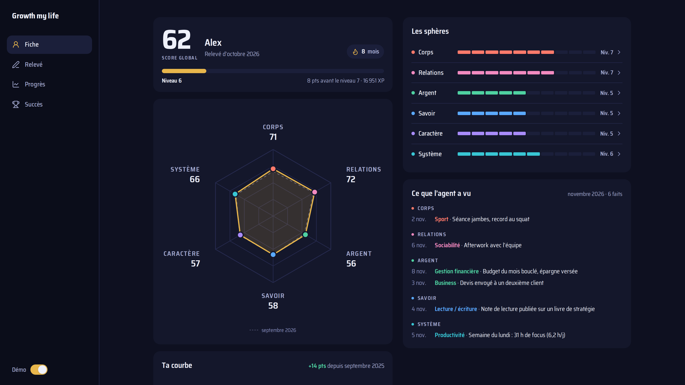

# Growth my life

Suivre sa vie, sphère par sphère, une fois par mois, avec un agent IA qui ramasse les faits à ta place.



Tu te notes sur **24 compétences** réparties en **6 sphères** (corps, relations, argent, savoir, caractère, système). La différence avec un tableau qu'on abandonne au bout de six mois : les faits, c'est l'agent qui les ramasse.

- **Trois nuits par semaine**, un agent Claude Code lit ce qui a bougé dans ton vault Obsidian (notes, sessions, tâches cochées, commits de tes projets, temps de focus) et range les **faits** du mois sous chaque compétence.
- **Le 1er du mois**, tu lances `/growthmylife` avec ton agent. Il te présente les faits, tu donnes une note et ton pourquoi, il te confronte quand tu te sous-estimes, écrit « comment m'améliorer » et tu prends 3 engagements.
- **La page** montre ta fiche (niveau, XP, série de mois tenus), ta roue, tes courbes de progression et le relevé à remplir. Elle marche sur téléphone.

Tout reste en Markdown dans ton vault : un fichier par mois (`Relevés/AAAA-MM.md`). Pas de base de données, pas de compte, rien dans le cloud.

## Ce qu'il y a dans le dépôt

| Dossier | Contenu |
| --- | --- |
| `src/` | Le serveur (page + API) et l'agent de nuit, en Node sans dépendance |
| `front/` | La page : React, Vite, Tailwind |
| `agent/executant-de-nuit.md` | Le brief de l'agent de nuit |
| `commande/growthmylife.md` | La commande Claude Code de la rétrospective mensuelle |
| `exemple/Relevés/_compétences.md` | La description des 24 compétences, affichée sur la page |
| `deploy/` | Services systemd, réglages d'exemple, workflow n8n (alertes et rappel du 1er) |

## Essayer en 2 minutes (mode démo)

Il faut Node 22 ou plus.

```bash
git clone <ce dépôt> growth-my-life && cd growth-my-life
cd front && npm ci && npm run build && cd ..
RELEVES_DIR=./exemple/Relevés npm run serveur
```

Ouvre http://127.0.0.1:5690 et active **Démo** : des données fictives, en lecture seule.

## L'installer pour de vrai

1. **Dans ton vault Obsidian**, crée un dossier (n'importe où, par exemple `Growth my life/`) avec un sous-dossier `Relevés/`. Copie-y `exemple/Relevés/_compétences.md` et le brief `agent/executant-de-nuit.md`.
2. **La commande** : copie `commande/growthmylife.md` dans `.claude/commands/` de ton vault, et remplace `<RELEVÉS>` par le chemin de ton dossier de relevés.
3. **Les réglages** : copie `deploy/growth-my-life.env.exemple` en `~/.config/growth-my-life.env` et remplis les chemins. `PRIVES` liste ce que l'agent ne doit jamais lire (journal intime, santé…).
4. **La page** : `cd front && npm ci && npm run build`, puis `npm run serveur` (avec les variables du fichier d'env), ou le service `deploy/growth-my-life.service`.
5. **L'agent de nuit** : il lui faut [Claude Code](https://claude.com/claude-code) installé et connecté. Lance un passage à la main avec `npm run passage`. Pour l'automatiser : `deploy/growth-my-life-passage.service` et `.timer` (lundi, mercredi, vendredi à 4 h).

Le premier passage regarde depuis le début du mois en cours. Le premier relevé, tu le fais le 1er du mois suivant avec `/growthmylife`.

### Sécurité de l'agent

L'agent tourne en `--permission-mode dontAsk` avec des droits bridés : il **lit** le vault, n'**écrit** que dans les fichiers du mois, et n'a ni terminal, ni web, ni sous-agent. Les chemins de `PRIVES` lui sont interdits en lecture. Seul le serveur MCP Promethee est chargé, si tu le configures.

La page n'a **pas d'authentification**. Garde `HOST=127.0.0.1`, ou mets-la derrière un réseau privé (Tailscale, WireGuard…). Ne l'expose jamais sur internet.

## Personnaliser

- **Les compétences** : renomme-les dans `src/axes.mjs`, puis recopie les mêmes noms dans le brief de l'agent et dans `_compétences.md`. Les 6 sphères sont liées aux couleurs de la page (`front/src/index.css`, `front/src/lib/outils.ts`).
- **Ton nom et celui de ton coach** : `NOM` et `COACH` dans le fichier d'env.
- **Le temps de focus** : l'axe Productivité peut s'appuyer sur Promethee via son MCP (`PROMETHEE_MCP`). Sans lui, tout le reste marche.
- **Le design** : `DESIGN.md` décrit le monde « fiche de personnage » (couleurs, typographie, composants). Le style est simple et largement perfectible : fais-toi plaisir.

## Le format d'un mois

```markdown
---
mois: 2026-11
statut: en cours
vu_jusqu_au: 2026-11-04T04:00
---

## Ce que l'agent a vu
### 🫀 Corps & Santé
- 2026-11-03 · Sport · Troisième séance de la semaine · [[Séance du 3 novembre]]

## Le relevé
### 🫀 Corps & Santé
| Compétence | Note | Objectif | Statut | Pourquoi | Comment m'améliorer |
...

## Engagements
```

La page lit et écrit ces fichiers ; le statut (en progrès, stagnation, recule) est calculé à ±5 points du dernier relevé.

## Tests

```bash
npm test
```

## Licence

MIT
